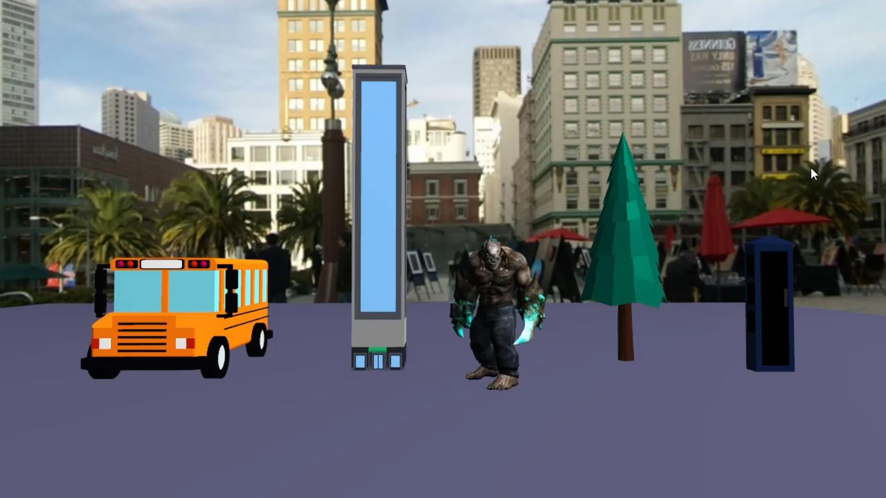
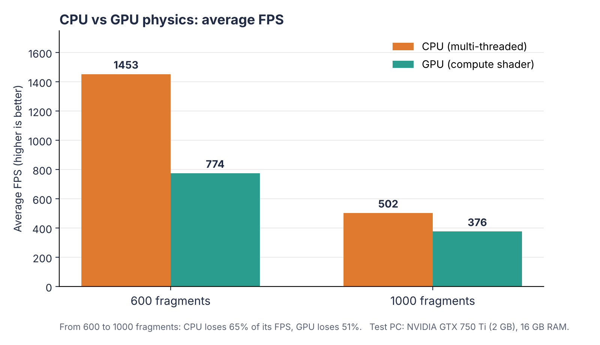

# Architectural Destruction Simulator

Real-time 3D simulator of architectural destruction, written in **C++ and OpenGL 4.3**. A character walks up to an object and punches it: the object, pre-fractured in Blender, bursts into hundreds of fragments that fly apart, bounce and settle on the ground. The fragment physics can run on the **CPU** or on the **GPU through compute shaders**, and you can **switch between the two at runtime** to compare them on the same scene.




<!-- DEMO-GIF  -->

> Experimental Bachelor's thesis, *Computer Science and Engineering*, University of Bologna (October 2025): **"Effetti Visivi Avanzati in CGI: Studio di Compute Shaders e Sistemi di Particelle con Applicazioni a Simulazioni Dinamiche"**.

## Highlights

- **Dual-mode physics.** One CPU implementation (multi-threaded) and one GPU implementation (compute shader with Shader Storage Buffer Objects), fed with the same fragment data and switchable with the `P` key.
- **Compute shader pipeline.** Per frame: update, dispatch, synchronize. Gravity, explosion impulse, damping and ground contact are computed in parallel on the GPU (`compute_physics.glsl`).
- **Explosion model.** An initial outward velocity that decays with distance and is made irregular by a noise factor; fragments bounce on the ground with simple friction.
- **Integration.** Semi-implicit Euler with exponential damping, for stable trajectories even with large time steps:

  ```
  v(t+dt) = v(t) + F(t)/m * dt          x(t+dt) = x(t) + v(t+dt) * dt
  v(t+dt) = (v(t) + g*dt) * exp(-k*dt)  (damping term)
  ```
- **Fracture pipeline.** Low-poly `.obj` models are shattered with Blender's *Cell Fracture* add-on (about 100 fragments for the bus, tree and phone booth, about 300 for the building in the performance tests) and exported to the simulator.
- **Skeletal animation.** A Mixamo character (idle, walking, punching) loaded from FBX with Assimp; bones are extracted per mesh (`aiBone`) by the `AnimatedModel` and `Animation` classes.
- **Collisions.** Axis-aligned bounding boxes for static objects, a capsule for the punch, continuous (swept) tests for fast hits, and a minimal push-out.
- **Debug tooling.** Debug UI, bounding-box visualisation and a performance monitor (FPS, physics time, CPU/GPU usage).

## CPU vs GPU results

Measured on a desktop PC with an NVIDIA GeForce GTX 750 Ti (2 GB) and 16 GB of RAM.



| | 600 fragments (GPU / CPU) | 1000 fragments (GPU / CPU) |
|---|---|---|
| Average FPS | 774.5 / 1452.8 | 376.0 / 502.5 |
| Min FPS | 459.5 / 1213.0 | 324.6 / 394.1 |
| Max FPS | 832.0 / 1642.8 | 441.0 / 589.3 |
| Average physics time (ms) | 0.6 / 0.003 | 0.7 / 0.015 |
| Average GPU usage (%) | 69.2 / 69.3 | 69.6 / 68.9 |

How to read it:

- At 600 and 1000 fragments the **CPU path is still faster in absolute terms**.
- The **GPU path scales better**: going from 600 to 1000 fragments the CPU loses about 65% of its average FPS, the GPU about 51%, and the GPU physics time barely moves (0.6 to 0.7 ms) while the CPU physics time grows five-fold.
- GPU usage is similar in both modes (about 69%), so at these sizes rendering dominates the frame time.
- The thesis argues that with more fragments the CPU would fall to or below the GPU. Only scenes of about 600 and 1000 fragments were measured, so that crossover is an expectation, not a result.

## Controls

| Key | Action |
|---|---|
| Arrow keys | Move the character (it punches when close to an object; a hit triggers the explosion) |
| `W` `A` `S` `D` | Move the camera |
| `Space` / `Left Shift` | Camera up / down |
| `C` | Enable / disable mouse camera control |
| `P` | Switch the fragment physics between CPU and GPU |
| `E` | Trigger the explosion manually |
| `R` | Reset the scene |
| `I` | Show debug information |
| `F` | Toggle fullscreen |
| `Esc` | Quit |

## Build and run (Windows)

**Requirements**

- Windows 10/11 and **Visual Studio 2022** (toolset v143, "Desktop development with C++")
- A GPU and driver supporting **OpenGL 4.3** or newer (needed by compute shaders)
- A dependencies folder at `C:\dependencies_GL_GLFW` (the path is set in the project properties under *C/C++ → Additional Include Directories* and *Linker → Additional Library Directories*; edit it if you put the folder elsewhere):

  ```
  C:\dependencies_GL_GLFW
  ├── include
  │   ├── GL/  GLFW/  KHR/  assimp/  glad/
  └── lib
      ├── glfw3.lib                (GLFW 3.4, Windows pre-compiled binaries)
      └── assimp-vc142-mt.lib      (Assimp built with the vc142 toolset)
  ```

- GLM 1.0.1 is restored automatically by NuGet (`packages.config`). GLAD (OpenGL 4.3 core) and `stb_image.h` are included in the repository.

**Steps**

1. Clone the repository and set up the dependencies folder as above.
2. Open `CELL_FRACTURE.sln`, select **Release | x64** and run **Build → Build Solution**.
3. Copy `assimp-vc142-mt.dll` next to the executable, in `x64\Release\`.
4. Run from Visual Studio (**Ctrl+F5**). Assets are loaded with relative paths, so the working directory must be the repository root, which is the Visual Studio default.

## Repository layout

The structure is flat on purpose: models, shaders and textures are loaded with relative paths.

| Area | Files |
|---|---|
| Application and rendering | `main.cpp`, `Application.*`, `Window.*`, `Renderer.*`, `Camera.*`, `Shader.*`, `Mesh.*`, `Model.*`, `Skybox.*`, `StateManager.*`, `InputHandler.*` |
| GPU physics | `ComputeShader.*`, `PhysicsSystem.*`, `compute_physics.glsl` |
| CPU physics | `PhysicsSystemCPU.*` |
| Character and animation | `Character.*`, `AnimatedModel.*`, `Animation.*`, `*_mostro.fbx`, `textures/` |
| Collisions and debug | `CollisionSystem.*`, `DebugBB.h`, `DebugUI.*`, `PerformanceMonitor.*`, `Logger.*` |
| Scene assets | `*.obj` / `*.mtl` (intact and fractured models), `skybox/` |
| Documentation | `docs/` |

## Documentation

- Thesis (Italian, 121 pages): [`docs/TESI_BRIGHI.pdf`](docs/TESI_BRIGHI.pdf), also on [AMS Laurea](https://amslaurea.unibo.it/id/eprint/36185/)
- Defence slides (Italian): [`docs/PRESENTAZIONE.pdf`](docs/PRESENTAZIONE.pdf)

## About this repository

The project was developed locally in Visual Studio, without version control, as my Bachelor's thesis work in 2025, and was uploaded to GitHub afterwards in a single commit. The history therefore shows one commit and not the actual development steps.

Small changes made at upload time, so that a clean clone builds:

- removed unused GLEW libraries from the linker settings;
- defined `GLM_ENABLE_EXPERIMENTAL` in `Animation.cpp`, which includes a GLM experimental extension;
- left out the stale `CMakeLists.txt` of the original folder: the project builds with the Visual Studio solution.

## Credits and licences

- **Source code:** MIT licence, see [`LICENSE`](LICENSE). Third-party assets and libraries keep their own licences.
- **Character and animations:** from [Mixamo](https://www.mixamo.com) (Adobe), included here only to let the simulator run as demonstrated. They are not covered by this repository's licence and must not be extracted or redistributed separately.
- **Low-poly models** (bus, tree, phone booth, building): from [Poly Pizza](https://poly.pizza), fractured with Blender's Cell Fracture. Each model keeps the licence and credit of its original author, listed on its Poly Pizza page.
- **Skybox:** from [OpenGameArt.org, "Urban Skyboxes"](https://opengameart.org/content/urban-skyboxes); author and licence are on the original page.
- **Libraries:** [GLFW](https://www.glfw.org), [GLAD](https://glad.dav1d.de), [GLM](https://github.com/g-truc/glm), [Assimp](https://www.assimp.org) and [stb_image](https://github.com/nothings/stb), each under its own open-source licence.
- **References:** the skeletal-animation approach follows the [OGLdev tutorial 38](https://ogldev.org/www/tutorial38/tutorial38.html); the compute-shader material draws on the Khronos OpenGL Wiki.

---

<details>
<summary><b>Riassunto in italiano</b></summary>

Simulatore interattivo di distruzione architettonica in **C++ e OpenGL 4.3**, realizzato per la tesi triennale in Ingegneria e Scienze Informatiche (Università di Bologna, ottobre 2025). Un personaggio animato colpisce un oggetto e questo si frantuma in centinaia di frammenti, la cui fisica può essere calcolata dalla **CPU** o dalla **GPU con i compute shader**, con passaggio dall'una all'altra a runtime (tasto `P`).

Risultati principali: a 600 e 1000 frammenti la CPU è ancora più veloce in valore assoluto (circa 1453 contro 774 FPS, e 503 contro 376 FPS), ma la GPU scala meglio: da 600 a 1000 frammenti la CPU perde circa il 65% degli FPS, la GPU circa il 51%. La tesi prevede che con più frammenti la CPU scenda sotto la GPU, ma questo non è stato misurato.

Il progetto è stato sviluppato in locale e caricato su GitHub in un unico commit. Tesi e slide, in italiano, sono nella cartella `docs/`.

</details>
